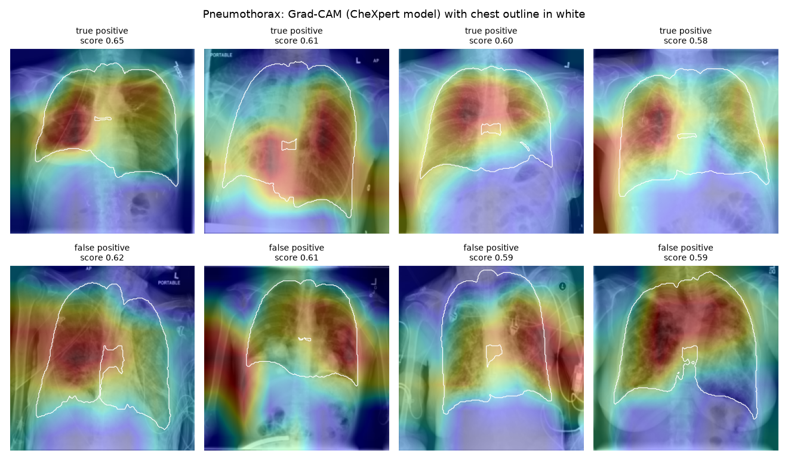

# Chest X-ray triage: external validation, adaptation and explainability

[](https://github.com/iMalcolmS/chest-xray-triage/actions/workflows/ci.yml) [](https://cxr-triage-demo.streamlit.app)

**Does a chest X-ray model trained at one hospital still work at another?** This project tests that on 5,606 NIH ChestX-ray14 images with pretrained DenseNet121 models from [torchxrayvision](https://github.com/mlmed/torchxrayvision), then measures what local adaptation recovers, how much data leakage would inflate the results, and where the model actually looks.

## Key findings

1. **External models lose accuracy at a new site.** On NIH images, the model trained on CheXpert (Stanford) scores lower AUC than the NIH-trained reference on 6 of 7 shared findings, and the one trained on MIMIC-CXR (Boston) on all 7. For Cardiomegaly, AUC falls from 0.857 to 0.679 (CheXpert) and 0.633 (MIMIC).
2. **Performance depends on how the X-ray was taken.** The CheXpert model scores 0.08–0.17 AUC lower on portable AP films than on PA films. AP films are 39% of the sample but 90–97% of the model's most confident Cardiomegaly and Effusion predictions, right or wrong.
3. **A small local head on top of the frozen model helps, if it builds on what the model already knows.** Stacking the CheXpert outputs with its image features and tuning regularisation by nested cross-validation improves 6 of 7 findings (+0.040 mean AUC). Cardiomegaly goes from 0.679 to 0.783. A head trained from scratch, my first attempt, made things worse (−0.041). Both results are kept.
4. **Splitting by image instead of by patient inflates AUC**, slightly on average (+0.006) but up to +0.048 for Fibrosis, a chronic condition with repeat films.
5. **Grad-CAM heatmaps are only partly inside the chest.** Scored against anatomical masks, 37–57% of heatmap weight falls in the lungs, heart and mediastinum (1.4–1.9× more than a uniform heatmap). False positives look in the same places as true positives.

## Results

All AUCs have 95% confidence intervals from a **patient-level bootstrap** (1,000 resamples). Patients are resampled, not images, because many patients have several films.

### 1. External validation

| Finding | Positives | CheXpert model (external) | MIMIC model (external) | NIH model (internal ref.) |
|:--|--:|:--|:--|:--|
| Atelectasis | 508 | 0.670 (0.649–0.692) | 0.674 (0.650–0.696) | 0.736 (0.716–0.756) |
| Cardiomegaly | 141 | 0.679 (0.633–0.721) | 0.633 (0.588–0.677) | 0.857 (0.825–0.885) |
| Consolidation | 226 | 0.757 (0.728–0.784) | 0.688 (0.654–0.718) | 0.777 (0.750–0.805) |
| Edema | 118 | 0.779 (0.742–0.813) | 0.781 (0.745–0.812) | 0.804 (0.768–0.835) |
| Effusion | 644 | 0.749 (0.729–0.766) | 0.763 (0.742–0.781) | 0.815 (0.798–0.832) |
| Pneumonia | 62 | 0.647 (0.579–0.712) | 0.595 (0.523–0.660) | 0.723 (0.667–0.775) |
| Pneumothorax | 271 | 0.695 (0.657–0.731) | 0.649 (0.617–0.683) | 0.690 (0.658–0.724) |

The NIH model may have seen some of these images in training, so its column is an optimistic reference, not a fair competitor. Full table: [results/external_validation.md](results/external_validation.md).

### 2. Adaptation and leakage

Frozen CheXpert backbone + a logistic-regression head per finding, 5-fold cross-validation split by patient, L2 strength chosen by an inner cross-validation on the training folds only.

| Finding | CheXpert zero-shot | Stacked head (patient split) | Same, image split (leaky) |
|:--|:--|:--|:--|
| Atelectasis | 0.670 | **0.720** | 0.724 |
| Cardiomegaly | 0.679 | **0.783** | 0.782 |
| Consolidation | 0.757 | **0.761** | 0.756 |
| Edema | 0.779 | **0.818** | 0.819 |
| Effusion | 0.749 | **0.789** | 0.786 |
| Pneumonia | **0.647** | 0.634 | 0.625 |
| Pneumothorax | 0.695 | **0.752** | 0.743 |

The head also learns findings CheXpert never saw: Emphysema reaches 0.723, above the NIH-trained model's 0.651. Pneumonia has only 62 positives and does not improve. Full tables with CIs: [results/adaptation.md](results/adaptation.md); first attempt: [results/adaptation_v1.md](results/adaptation_v1.md).

### 3. AP vs PA films

| Finding | Model, PA only | Model, AP only | AP share: top 5% scores | AP share: positives |
|:--|:--|:--|--:|--:|
| Atelectasis | 0.703 | 0.584 | 90% | 51% |
| Cardiomegaly | 0.726 | 0.643 | 97% | 45% |
| Consolidation | 0.762 | 0.677 | 92% | 65% |
| Effusion | 0.790 | 0.703 | 94% | 48% |
| Pneumothorax | 0.752 | 0.587 | 25% | 35% |

The view alone barely predicts disease (AUC 0.48–0.56 for Atelectasis, Cardiomegaly, Effusion and Pneumothorax), so the model is not exploiting a useful cue; it is being misled by one. AP films come from bed-bound and ward patients, which is where automated triage would matter most. Two explanations are plausible: AP projection magnifies the heart, and portable films carry markers, tubes and lines. Full table: [results/view_confounding.md](results/view_confounding.md).

### 4. Grad-CAM audit

For each finding, the 30 most confident true positives and 30 most confident false positives (one image per patient). Heatmaps are scored against lung, heart and mediastinum masks from torchxrayvision's segmentation model.

| Finding | Group | Heatmap inside chest | Lift over uniform |
|:--|:--|--:|--:|
| Cardiomegaly | true positive | 56.7% | 1.94 |
| Cardiomegaly | false positive | 52.2% | 1.89 |
| Effusion | true positive | 41.8% | 1.57 |
| Effusion | false positive | 37.2% | 1.63 |
| Pneumothorax | true positive | 47.8% | 1.40 |
| Pneumothorax | false positive | 48.8% | 1.41 |



Top row: confident true positives. Bottom row: confident false positives, including heat over soft tissue outside the chest and over devices and lines. More: [Cardiomegaly](results/gradcam_cardiomegaly.png), [Effusion](results/gradcam_effusion.png), [full table](results/gradcam_audit.md).

## Triage service

The findings above are turned into a deployable triage API (FastAPI) and a [live demo](https://cxr-triage-demo.streamlit.app):

- **DICOM in, FHIR out.** `/predict` accepts DICOM, PNG or JPEG, reads the view (AP/PA) from the DICOM header, and returns per-finding scores, a FHIR R4 `DiagnosticReport` and an optional Grad-CAM overlay.
- **View-aware thresholds.** Thresholds are set for 80% sensitivity separately on AP and PA films ([results/thresholds.md](results/thresholds.md)). With one shared threshold, AP films were over-flagged (specificity 0.15–0.34) and PA cases were missed (sensitivity 0.62–0.72 for Atelectasis, Cardiomegaly, Consolidation and Effusion). Per-view thresholds bring both views close to 80% sensitivity; for example Effusion AP specificity rises from 0.30 to 0.52 and Consolidation PA sensitivity from 0.62 to 0.85.
- **Refuses to guess.** Where the model's AUC on a view is below 0.60, that finding is reported as "not reported on this view" instead of producing near-random alarms.
- **No patient identifiers** are returned or logged; each request logs only latency, view and flags for monitoring.
- **Documented for a hospital assessment.** [MODEL_CARD.md](MODEL_CARD.md) has the intended use, a DCB0129-style hazard log, DTAC notes and a monitoring plan.
- **Tested and packaged.** CI runs the test suite and builds the Docker image on every push; the image is published to GitHub Container Registry.

```bash
docker run -p 7860:7860 ghcr.io/imalcolms/chest-xray-triage:latest
# then open http://localhost:7860/docs
curl -F "file=@chest.dcm" "http://localhost:7860/predict?heatmap=true"
```

Even with per-view thresholds, specificity at 80% sensitivity stays between about 0.2 and 0.6 for most findings, so this would still raise many false alarms in practice: it is a research prototype, not a medical device.

## Limitations

- **Noisy labels.** NIH labels were text-mined from reports; a radiologist review found them often inaccurate ([Oakden-Rayner, 2019](https://arxiv.org/abs/1907.12720)). Absolute AUCs are lower than published NIH results partly for this reason.
- **Low resolution.** Models run at 224 px, which hides small nodules; Mass and Nodule are near chance for every model.
- **One sample, one external site.** 5,606 images from 4,230 patients (the public NIH random sample). Findings with few positives (Pneumonia: 62; Edema on PA films: 12) have wide intervals.
- **NIH reference may be optimistic.** The NIH-trained model may have seen some of these images.
- **Grad-CAM is coarse** (7×7 feature map) and the in-chest metric cannot tell a chest drain inside the thorax from disease.
- **Not a medical device.** Research code only; not for clinical use.

## Reproduce

Tested on an Intel Mac (CPU only, PyTorch 2.2.2).

```bash
python3 -m venv .venv && source .venv/bin/activate
pip install -r requirements.txt
python -m pytest -q
```

Download the [NIH ChestX-ray14 random sample](https://www.kaggle.com/datasets/nih-chest-xrays/sample) and place `images/` and `sample_labels.csv` in `data/nih_sample/`. Then run, in order:

```bash
python -m scripts.external_validation   # 3 models x 5,606 images (~1 h on CPU)
python -m scripts.extract_features      # features + preprocessed image cache (~20 min)
python -m scripts.adapt                 # nested-CV heads, leakage comparison (~15 min)
python -m scripts.view_confounding      # AP vs PA analysis (~2 min)
python -m scripts.gradcam_audit         # Grad-CAM + anatomical masks (~25 min)
```

## Project layout

```
cxr/
  data.py        load labels, preprocess images for torchxrayvision
  metrics.py     AUC with patient-level bootstrap CI
  adapt.py       patient-grouped splits, nested-CV logistic heads
  explain.py     Grad-CAM on raw logits, anatomical chest masks
service/         triage API: DICOM/PNG input, per-view thresholds, FHIR output
demo/            Streamlit demo and DICOM samples from NIH ChestX-ray14
scripts/         one script per analysis (see Reproduce)
tests/           unit tests (pytest)
results/         tables and figures committed from each run
```

## Data and models

- Data: NIH Clinical Center, [ChestX-ray14](https://nihcc.app.box.com/v/ChestXray-NIHCC) (Wang et al., CVPR 2017). Images are not redistributed here.
- Models: pretrained DenseNet121 and chest segmentation (PSPNet) from [torchxrayvision](https://github.com/mlmed/torchxrayvision) (Cohen et al.).
- Explanations: [pytorch-grad-cam](https://github.com/jacobgil/pytorch-grad-cam).
